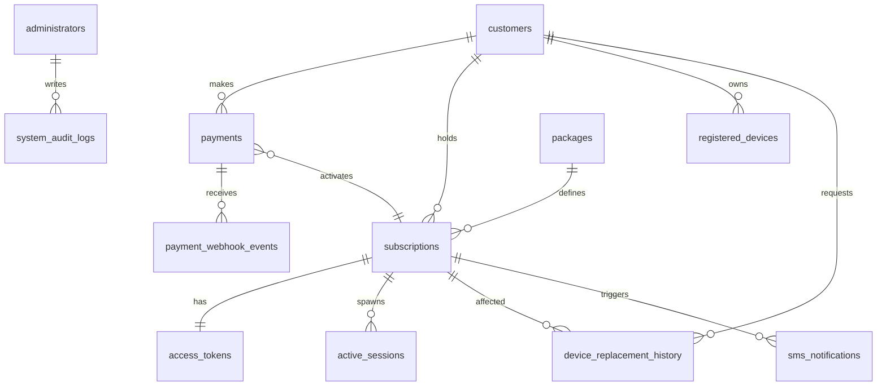

# Implementation Plan — Phases 2 to 7

**Phase:** 1 deliverable — plan for approval before any code
**Date:** 2026-11-23
**Rule:** no phase starts until the previous phase's report is accepted (master prompt §17, §20).

---

## 0. Current status

- ✅ Phase 1 (preliminary): G5TS feasibility researched, options compared, MVP scoped, decisions
  logged, this plan produced.
- ⏸ **PAUSED FOR APPROVAL** — owner reviews this plan, runs ZTE checklist T1–T9, approves
  Option B1/C/A choice, then Phase 2 begins.

---

## 1. Phase 2 — System Planning and Design

**Deliverables**

| # | Artifact | Path |
|---|---|---|
| 1 | Functional & non-functional requirements | `docs/architecture/requirements.md` |
| 2 | Use-case diagram + narratives (purchase, reconnect, expiry, device replacement, admin ops) | `docs/architecture/use-cases.md` |
| 3 | System architecture (component + deployment diagrams) | `docs/architecture/system-architecture.md` |
| 4 | Database ER diagram (final) | `docs/database/er-diagram.md` |
| 5 | API contract (OpenAPI-style spec) | `docs/api/api-contract.md` |
| 6 | Interface designs (wireframes: portal + admin) | `docs/architecture/ui-wireframes.md` |
| 7 | Final network architecture (after T1–T9 results) | `docs/network/network-architecture-options.md` (update) |

**Acceptance criteria:** every master-prompt requirement traceable to at least one requirement
entry; ER covers all §16 entities with constraints; API contract covers all portal/admin flows;
no open question from the decision log blocks development.

## 2. Phase 3 — Frontend Development

Order: design system (tokens, Tailwind theme per §14: navy/electric-blue/green/amber/red) →
shared components → customer portal → admin shell → admin pages.

- Realistic **mock data** only (mocked API layer with typed fixtures) — swapped for live API in
  Phase 6 integration.
- Pages: portal (landing, package select, purchase, token login, subscription info, device
  replacement request), admin (login, overview, customers, packages, subscriptions, payments,
  network, analytics, audit log).
- Responsive from day one: customer = mobile-first; admin = desktop-first with collapsible
  sidebar. Test at 360×800, 390×844, 768×1024, 1024×768, 1366×768, 1920×1080.

**Acceptance criteria:** all six viewports pass (no overflow/overlap); Lighthouse a11y ≥ 90 on
key pages; storybook-style component inventory documented; mock API isolated behind
`services/` for one-line live swap.

## 3. Phase 4 — Backend Development

Order: project skeleton (Spring Boot 21, Flyway, security baseline) → auth (JWT admin) →
packages → customers/tokens → payments (abstraction + Daraja sandbox) → subscriptions &
expiry scheduler → device management → analytics APIs → hardening (rate limits, audit logs,
webhook verification).

- Test-first for money paths: duplicate webhook, concurrent purchase for same phone,
  token brute-force, expiry boundary conditions.

**Acceptance criteria:** ≥ 80 % line coverage on `service` layer for payment/subscription/token
modules; all master-prompt §20 rules 6–8 enforced by tests; OpenAPI contract matches
implementation (contract test).

## 4. Phase 5 — Integrations

1. **Payment:** Daraja sandbox end-to-end (STK push → C2B/callback verification → activation),
   idempotency keys, signature verification, replay protection.
2. **SMS:** Africa's Talking sandbox (token + confirmation), delivery-status recording, retry
   with backoff, admin resend endpoint.
3. **Hotspot:** MikroTik RouterOS API adapter against a lab device (or CHR trial instance),
   Mock adapter for CI; Null adapter demo for Option A mode.

**Acceptance criteria:** each integration runs in its vendor sandbox with credentials supplied
by owner; docs state exactly what was and was not tested (honesty rule); switching providers
requires only configuration + one adapter class.

## 5. Phase 6 — Testing

- **Integration E2E:** purchase → SMS → login → session → expiry → revocation (sandbox).
- **Failure matrix:** failed/expired/duplicate payments; SMS outage; controller offline;
  token brute force; expired token; device replacement; renewal-extension (D-007); suspended
  customer; concurrent sessions rejected.
- **Revenue reconciliation:** analytics vs raw payments table, timezone-boundary tests
  (Africa/Dar_es_Salaam), refund exclusion.
- **Security:** authz (non-admin → admin endpoints), SQLi/XSS/CSRF probes, webhook forgery,
  log-scan asserting no tokens/credentials present.
- **Responsive QA:** all six viewports, both UIs, scripted checklist.

**Acceptance criteria:** all §17 Phase-6 test categories executed with a written pass/fail
report; zero critical/high defects open.

## 6. Phase 7 — Deployment

- `docker-compose.yml` (prod profile), `.env.example` with every required variable, Nginx
  reverse proxy + TLS (ACME or self-signed for LAN), Flyway auto-migrate on boot.
- Structured JSON logging + log rotation; daily PG dump script with retention policy;
  restore runbook; backup verification step.
- Deployment doc: on-site server setup, MikroTik provisioning steps, walled-garden config,
  degraded-mode behaviour, health checks, upgrade procedure.
- Final `README.md` + `CHANGELOG.md` v1.0.0.

**Acceptance criteria:** clean-clone → `docker compose up` → full sandbox E2E passes on the
on-site machine; restore-from-backup drill documented; owner runbook reviewed.

---

## 7. API contract outline (draft — full spec in Phase 2)

### Public (customer portal, no auth)

| Method | Path | Purpose |
|---|---|---|
| GET | `/api/v1/packages` | Active packages (from DB) |
| POST | `/api/v1/purchases` | Initiate purchase `{phone, packageId}` → payment session |
| GET | `/api/v1/purchases/{id}` | Purchase status (pending/success/failed) |
| POST | `/api/v1/webhooks/payments/{provider}` | Provider callback (signature-verified, idempotent) |
| POST | `/api/v1/auth/token-login` | `{token}` → subscription/session (rate-limited) |
| GET | `/api/v1/subscriptions/current?token=` | Subscription info for token holder |
| POST | `/api/v1/device-replacement-requests` | `{token, reason, newDeviceHint}` → pending admin approval |

### Admin (`/api/v1/admin/**`, JWT + role ADMIN)

| Group | Endpoints (summary) |
|---|---|
| Auth | `POST /auth/login`, `POST /auth/refresh`, `GET /auth/me` |
| Dashboard | `GET /stats/overview?range=` (revenue today/week/month/year/total, KPIs) |
| Customers | `GET /customers?search=`, `GET /customers/{id}`, `POST /customers/{id}/suspend|reactivate` |
| Devices | `GET /customers/{id}/device`, `POST /device-replacements/{id}/approve|reject`, `POST /customers/{id}/disconnect` |
| Packages | `GET/POST/PUT /packages`, `POST /packages/{id}/activate|deactivate` |
| Subscriptions | `GET /subscriptions?status=`, `POST /subscriptions/{id}/suspend|revoke`, `GET /subscriptions/{id}/history` |
| Payments | `GET /payments?filters=`, `POST /payments/{id}/resend-token` |
| Analytics | `GET /analytics/revenue?from&to&packageId&status`, `GET /analytics/packages`, `GET /analytics/customers`, `GET /analytics/export.csv` |
| Network | `GET /network/sessions`, `POST /network/sessions/{grantRef}/disconnect`, `GET /network/health` |
| Audit | `GET /audit-logs?filters=` |

## 8. Database ER draft (refined in Phase 2)



Key constraints (draft): `customers.phone_e164` UNIQUE; `payments.provider_reference` UNIQUE
(when present); `access_tokens.token_hash` UNIQUE + `status`; one ACTIVE subscription per
customer optional business rule enforced in service layer (multi-package stacking allowed per
D-007); `subscriptions.ends_at > starts_at`; partial indexes on `status='ACTIVE'`;
all money in integer TZS; all timestamps `timestamptz`.

## 9. Risk register

| Risk | Likelihood | Impact | Mitigation |
|---|---|---|---|
| Daraja merchant eligibility/credentials delayed | High | Payment feature blocked | Sandbox-first development; provider abstraction means swap is cheap; plan manual "cash to admin" fallback? — **not** in scope without approval |
| ZTE T7 (bridge) fails → Option C invalid | Medium | Small cost increase | B1 recommended anyway; T7 only affects cost/SSID choice |
| MikroTik unavailable/overpriced locally | Low | Delay | Option B2 (Pi) fallback documented |
| Africa's Talking account delayed | Medium | Token delivery blocked | Mock provider for dev; admin can display token once **in-person only** (flagged, audited) — pending owner approval if needed |
| Scope creep (9 components) | Medium | Schedule slip | `mvp-scope.md` is binding; new items → decision log |
| 5G uplink instability | Medium | Payments/SMS down | Degraded local mode documented; portal/admin keep working on LAN |

## 10. Inputs needed from owner (summary)

1. **Now (to close Phase 1):** approval of this plan + D-009 architecture choice after T1–T9.
2. **Phase 3:** business name, logo, colours confirmation, support contact, example packages
   with real prices.
3. **Phase 5:** Daraja + Africa's Talking sandbox credentials (secure channel, never git).
4. **Phase 7:** on-site machine specs (or approval to buy a Pi 5 / mini PC), domain name or
   LAN-only TLS decision.

## 11. Per-phase reporting format (master prompt §20 — will be used at every phase gate)

```
## Phase N report
1. What was completed
2. Files created or modified
3. Tests performed and results
4. Remaining tasks
5. Known limitations
6. Next recommended phase (awaiting approval)
```
