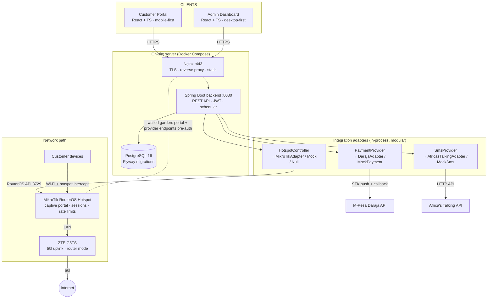
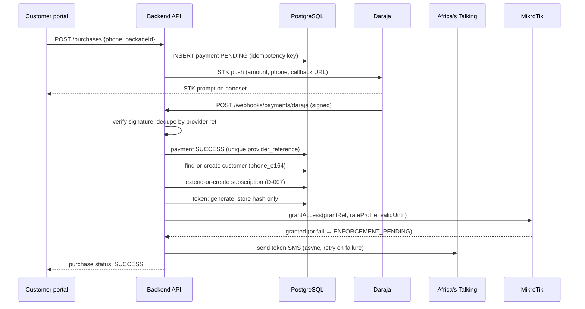

# System Architecture

**Phase:** 2 — System Planning and Design
**Status:** Approved baseline (Phase 2 approval: 2026-11-23)
**Date:** 2026-11-23

---

## 1. Component architecture



**Design rule:** the frontend and business services depend only on the adapter *interfaces*
(`docs/network/hotspot-adapter-design.md`); vendor specifics live in one adapter class each.

## 2. Deployment architecture (Option B1, recommended)

```
                    ┌─────────────────────────────────────────────┐
 Internet ──5G─────►│ ZTE G5TS (router mode, NAT, untouched)      │
                    └───────────────┬─────────────────────────────┘
                                    │ LAN cable (WAN side)
                    ┌───────────────▼─────────────────────────────┐
                    │ MikroTik hAP ax lite — RouterOS Hotspot     │
                    │ · customer SSID + captive portal redirect    │
                    │ · per-user rate limits (package profile)     │
                    │ · client isolation · walled garden           │
                    └───────┬─────────────────────┬───────────────┘
                            │ Wi-Fi (customers)   │ LAN
                    ┌───────▼───────┐     ┌───────▼──────────────────────┐
                    │ Customer      │     │ On-site server (Pi 5/miniPC) │
                    │ devices       │     │ Nginx · Spring Boot · Postgres│
                    └───────────────┘     └──────────────────────────────┘
                                              │ outbound HTTPS (uplink required)
                                     ┌────────┴────────┐
                                     ▼                 ▼
                              M-Pesa Daraja     Africa's Talking
```

- **Pre-auth reachability:** Nginx/portal URLs are whitelisted in the hotspot walled garden, so
  an unauthenticated customer can load the portal and complete payment (providers also whitelisted
  for the STK/callback round-trip initiated from the portal session).
- **Degraded mode (uplink down):** portal browsing, package list, token login, admin dashboard
  and expiry enforcement keep working on the LAN; payment initiation and SMS show an honest
  "temporarily unavailable" state; MikroTik keeps enforcing existing sessions.
- **Option A (soft-gate):** same server, `hotspot.controller=null`, dashboard badges
  "Enforcement: OFF". **Option C:** gated on test T7; if adopted, MikroTik role moves into the
  gateway device behind a bridged ZTE (see `network-architecture-options.md`).

## 3. Backend internal architecture (modular monolith)

```
backend/src/main/java/com/hotspot/
├── api/                # REST controllers (thin: validate → call service → map)
│   ├── publicapi/      # packages, purchases, webhook, token-login, subscription, device-replacement
│   └── adminapi/       # auth, stats, customers, packages, subs, payments, network, analytics, audit
├── domain/             # entities + enums (JPA) — no framework leaks
├── repository/         # Spring Data JPA repositories
├── service/            # business logic (transactional)
│   ├── PaymentService · SubscriptionService · TokenService
│   ├── CustomerService · DeviceService · ExpiryService · AnalyticsService
├── integration/        # adapters — ONLY place vendor SDKs appear
│   ├── payment/{PaymentProvider, DarajaAdapter, MockPayment}
│   ├── sms/{SmsProvider, AfricasTalkingAdapter, MockSms}
│   └── hotspot/{HotspotController, MikroTikAdapter, MockController, NullController}
├── security/           # JWT filter, RBAC, rate limiting, CORS
├── scheduler/          # expiry (1min), reconciliation (1h), sms-retry (5min)
└── common/             # logging, errors, audit, config
```

- **Layer rule:** `api → service → (repository | integration)`; no cross-calls skipping layers.
- **Config selection:** `hotspot.controller=mikrotik|mock|null`, `payment.provider=daraja|mock`,
  `sms.provider=africastalking|mock` — profiles per environment (dev/test/prod).

## 4. Key runtime flows

### 4.1 Purchase → access (sequence)



### 4.2 Expiry (scheduled, every minute)

`SELECT active WHERE ends_at <= now()` → per row in one transaction: `EXPIRED` →
`revokeAccess(grantRef)` → token revoked → device authorization cleared → audit + session
events → history untouched. Failed controller calls are queued for UC16 reconciliation.

## 5. Security architecture (maps NFR-03)

| Concern | Implementation |
|---|---|
| Admin auth | Login → bcrypt verify → JWT (short-lived access + refresh rotation); secret from env |
| Authorization | Role `ADMIN` on all `/api/v1/admin/**`; public portal endpoints strictly limited to the contract |
| Payment webhooks | Provider signature/IP verification + timestamp window + idempotency key |
| Rate limiting | Token login (per IP+phone), purchase initiation (per phone), login (per IP) — bucketed in-memory (single node) |
| Injection | JPA/parameterized queries only; no string-built SQL; input validation via Jakarta annotations + DTO allowlists |
| CORS | Allowlist = portal/admin origins only; Nginx same-origin in prod |
| CSRF | Stateless JWT in Authorization header (no cookies) → CSRF not applicable; documented |
| Secrets | Env vars only; `.env.example` has placeholders; git-ignored `.env` |
| Audit | Every admin mutation → `system_audit_logs` (actor, action, entity, before/after diff, IP) |
| Logging | Structured JSON; deny-list for `token`, `password`, `authorization`, `pin` fields |
| Transport | TLS 1.2+ at Nginx; RouterOS API over TLS (8729) |

## 6. Environments

| Env | Profile | Payment/SMS | Hotspot | DB |
|---|---|---|---|---|
| Local dev | `dev` | mock | mock | compose Postgres |
| Integration test | `test` | mock (fault injection) | mock | Testcontainers |
| Staging | `staging` | Daraja **sandbox** + AT **sandbox** | MikroTik (lab) or mock | compose |
| Production | `prod` | live credentials (Phase 5, owner-supplied) | MikroTik on-site | compose + nightly dumps |

## 7. Traceability

- Modular integration layer → master §3 + D-010
- On-site hosting + walled garden → D-005, D-009
- Degraded modes → NFR-04, FR-C12
- Modular monolith, no microservices → §2, D-013
- Layered backend structure → clean-architecture requirement (§2)
