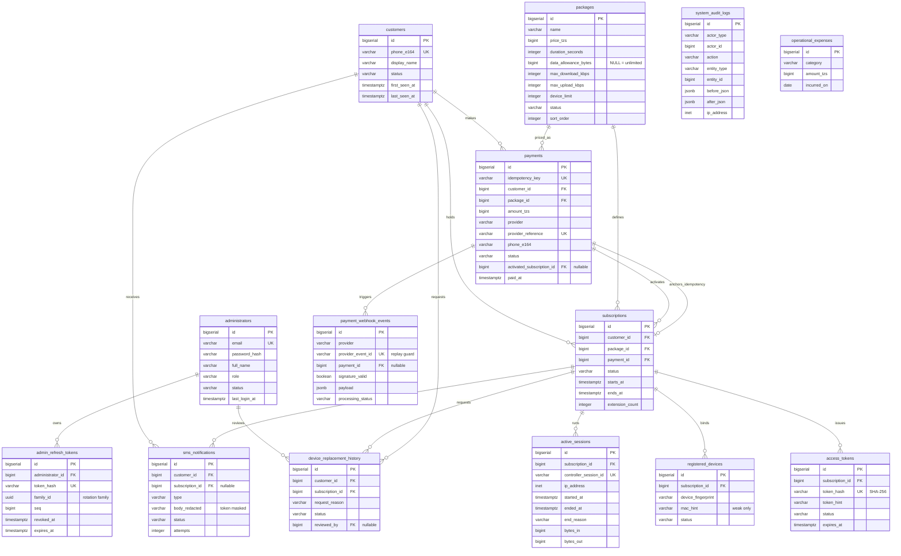

# Database Documentation

Source of truth: `backend/src/main/resources/db/migration/V1__init.sql` (approved Phase 2 ER,
`docs/database/er-diagram.md`, D-021) + `V2__admin_refresh_tokens.sql` (D-025).
Conventions: `BIGSERIAL` PKs · money = `BIGINT` TZS (integer) · all times `TIMESTAMPTZ` stored UTC ·
financial rows never hard-deleted (NFR-06) · enums as constrained `VARCHAR` columns.
Owner: PostgreSQL (verified schema only — the audit **did not connect to any database**; no
credentials available and no destructive operations performed).

---

## 1. Table inventory (14 tables)

| # | Table | Purpose | Rows seeded |
|---|---|---|---|
| 1 | `administrators` | Admin accounts (email UNIQUE, bcrypt `password_hash`, role, status, last_login) | 0 (bootstrap from env) |
| 2 | `customers` | Customers keyed by `phone_e164` UNIQUE (E.164, one account per number, FR-A01) | 0 |
| 3 | `packages` | Sellable packages: price, duration, data/speed limits, device limit, status, sort | **6** (INSERT seed, FR-P02) |
| 4 | `payments` | Financial ledger: `idempotency_key` UNIQUE, provider refs, status, `activated_subscription_id` FK (idempotency anchor) | 0 |
| 5 | `subscriptions` | Access periods: starts/ends, status, `extension_count`, suspended reason | 0 |
| 6 | `access_tokens` | `token_hash` UNIQUE (SHA-256), `token_hint` (last 4), status, expiry | 0 |
| 7 | `registered_devices` | Device binding per subscription: fingerprint (session id + UA hash), `mac_hint` (weak, FR-S06) | 0 |
| 8 | `active_sessions` | Controller sessions: `controller_session_id` UNIQUE, IP `INET`, bytes, `end_reason` | 0 |
| 9 | `device_replacement_history` | Replacement requests + admin decision (FR-C09/FR-S03) | 0 |
| 10 | `sms_notifications` | SMS log with **redacted** body (`****7Q2F`), provider, status, attempts | 0 |
| 11 | `payment_webhook_events` | Webhook replay guard: UNIQUE(`provider`,`provider_event_id`), signature flag, raw payload JSONB | 0 |
| 12 | `system_audit_logs` | Audit trail: actor, action, entity, before/after JSONB, IP | 0 |
| 13 | `operational_expenses` | v1.1 profit stub (FR-R05) — unused in MVP | 0 |
| 14 | `admin_refresh_tokens` *(V2)* | Refresh sessions: `token_hash` UNIQUE, `family_id` rotation family, seq, revoked/expires | 0 |

## 2. Relationships & referential integrity (FKs, all `NOT NULL` unless shown)

```
administrators ──< device_replacement_history.reviewed_by (nullable)
customers ──< payments >── packages
customers ──< subscriptions >── packages
payments ──< subscriptions (subscriptions.payment_id)
payments >── subscriptions (payments.activated_subscription_id, nullable, added by ALTER)
subscriptions ──< access_tokens
subscriptions ──< registered_devices
subscriptions ──< active_sessions
subscriptions ──< device_replacement_history >── customers
customers ──< device_replacement_history
customers ──< sms_notifications ──> subscriptions (nullable)
payments ──< payment_webhook_events (nullable payment_id)
administrators ──< admin_refresh_tokens (V2)
```

All FKs are unindexed at the child side **except** where an index on the FK column exists implicitly
via composite indexes (e.g. `idx_payments_customer_created` covers `customer_id`). PostgreSQL does
not auto-index FKs — child-side lookups that lack an index are noted in §5.

## 3. Keys, constraints, indexes

**UNIQUE constraints:** `administrators.email` · `customers.phone_e164` ·
`payments.idempotency_key` · `payments.provider_reference` · `access_tokens.token_hash` ·
`active_sessions.controller_session_id` · `payment_webhook_events(provider, provider_event_id)` ·
`admin_refresh_tokens.token_hash`.

**CHECK constraints:** `packages.price_tzs > 0`, `duration_seconds > 0`, `device_limit >= 1` ·
`payments.amount_tzs > 0` · `subscriptions.ends_at > starts_at` ·
`operational_expenses.amount_tzs >= 0`.

**Partial unique index:** `uq_sessions_live ON active_sessions(subscription_id) WHERE ended_at IS NULL`
— enforces **one live session per subscription** (FR-S01) at the DB level.

**Other indexes:** `idx_customers_status` · `idx_packages_status_sort` ·
`idx_payments_customer_created` · `idx_payments_status_paid_at` ·
`idx_subscriptions_status_ends_at` · `idx_subscriptions_customer_status` ·
`idx_tokens_subscription_status` · `idx_devices_subscription_status` ·
`idx_sessions_subscription_started` · `idx_replacements_status_created` · `idx_replacements_customer` ·
`idx_sms_status_created` · `idx_audit_entity` · `idx_audit_created` ·
`idx_refresh_family` · `idx_refresh_admin` (V2).

**Deferred FK:** `payments.activated_subscription_id` added by `ALTER TABLE` after `subscriptions`
exists (circular dependency handled correctly).

## 4. ER diagram (Mermaid)



## 5. Audit observations

| # | Observation | Evidence | Impact | Priority |
|---|---|---|---|---|
| D-1 | Schema is **richer than any code path can populate it** — 14 tables, but no controllers write them; the DB has never been migrated in this environment | no `@RestController` anywhere; backend doesn't compile | Dead schema until Phase 4 API layer lands | HIGH (context) |
| D-2 | Enum-as-VARCHAR has **no CHECK constraints** on status columns (`payments.status`, `subscriptions.status`, etc.) | V1 DDL | A bug could persist an invalid status; JPA enums mitigate in practice but DB won't reject it | MEDIUM |
| D-3 | FK child-side indexes missing for some lookups: `access_tokens.subscription_id` has a composite index (OK), but `sms_notifications.customer_id`, `payment_webhook_events.payment_id`, `admin_refresh_token`-style lookups by parent lack single-column indexes | V1 DDL | Seq scans as data grows (SMS/webhook tables can grow fast) | MEDIUM |
| D-4 | `active_sessions` stores placeholder IP `10.10.0.2` in code (`SubscriptionService.applyGrant`) | `SubscriptionService.java:146` | Dashboard "IP" column is fake until MikroTik sync (Phase 5) — violates FR-D06 "never fabricated" if exposed as real | HIGH |
| D-5 | `payments.activated_subscription_id` is the idempotency anchor, but **no unique constraint** prevents two subscriptions being attached to one payment | V1 DDL | Double activation possible if a future service layer races; code guards on `payment.status == PENDING` only | HIGH |
| D-6 | No `updated_at` triggers — `updated_at DEFAULT now()` is set by JPA entities, not DB | V1 DDL | Rows written outside JPA won't refresh `updated_at`; acceptable but worth knowing | LOW |
| D-7 | `system_audit_logs` has no retention/archival policy table | V1 DDL | Unbounded growth over years | LOW (v1.1) |
| D-8 | Seed packages hardcode TZS prices in SQL (intentional, FR-P02: owner-editable seed) | V1 `INSERT` | None — by design; editable via admin UI once A14–A16 exist | — |
| D-9 | `operational_expenses` unused (documented v1.1 stub) | FR-R05 | Profit column in analytics must stay null until then | — |

## 6. Scalability assessment

Single-node PostgreSQL is correct for a ≤64-client hotspot (NFR-05). Design supports the load:
integer money, indexed hot paths, partial unique index, pessimistic-lock sweep safe for concurrent
nodes if ever scaled. Long-term concerns: `system_audit_logs`/`payment_webhook_events` growth
(needs archival), analytics queries scanning `payments` over 12 months (indexes cover the common
filters; verify against NFR-10 once running).
