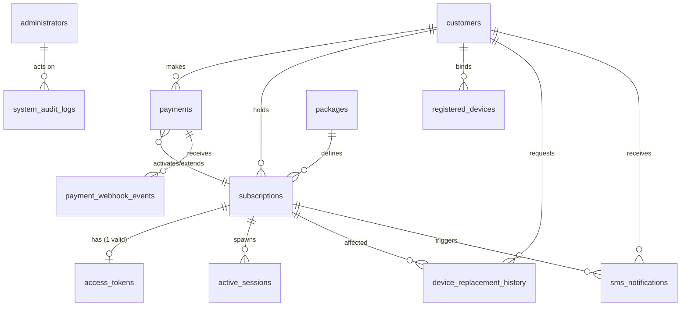

# Database Design & ER Diagram

**Phase:** 2 — System Planning and Design
**Status:** Approved baseline (Phase 2 approval: 2026-11-23) — will become Flyway `V1__init.sql`
**Conventions:** `BIGSERIAL` PKs; all money = `BIGINT` TZS (integer); all times `TIMESTAMPTZ`;
`created_at/updated_at` on every table; soft states via status enums — financial rows are
**never** hard-deleted (NFR-06, FR-A06).

---

## 1. ER diagram

## 2. Tables

### administrators
| Column | Type | Constraints |
|---|---|---|
| id | bigserial | PK |
| email | varchar(255) | NOT NULL, UNIQUE |
| password_hash | varchar(255) | NOT NULL (bcrypt/argon) |
| full_name | varchar(120) | NOT NULL |
| role | varchar(20) | NOT NULL DEFAULT 'ADMIN' (v1 single role) |
| status | varchar(20) | NOT NULL DEFAULT 'ACTIVE' (ACTIVE/DISABLED) |
| last_login_at | timestamptz | |
| created_at, updated_at | timestamptz | NOT NULL |

### customers
| Column | Type | Constraints |
|---|---|---|
| id | bigserial | PK |
| phone_e164 | varchar(15) | NOT NULL, UNIQUE — `+255XXXXXXXXX` normalized |
| display_name | varchar(120) | nullable |
| status | varchar(20) | NOT NULL DEFAULT 'ACTIVE' (ACTIVE/SUSPENDED) |
| first_seen_at, last_seen_at | timestamptz | |
| created_at, updated_at | timestamptz | NOT NULL |

*Index:* UNIQUE(phone_e164); INDEX(status)

### packages
| Column | Type | Constraints |
|---|---|---|
| id | bigserial | PK |
| name | varchar(80) | NOT NULL (e.g. "24 Hours") |
| description | varchar(500) | |
| price_tzs | bigint | NOT NULL CHECK (price_tzs > 0) |
| duration_seconds | integer | NOT NULL CHECK (duration_seconds > 0) |
| data_allowance_bytes | bigint | NULL (NULL = unlimited) |
| max_download_kbps | integer | NULL (NULL = unlimited) |
| max_upload_kbps | integer | NULL | |
| device_limit | integer | NOT NULL DEFAULT 1 CHECK (device_limit >= 1) |
| status | varchar(20) | NOT NULL DEFAULT 'ACTIVE' (ACTIVE/INACTIVE) |
| sort_order | integer | NOT NULL DEFAULT 0 |
| created_at, updated_at | timestamptz | NOT NULL |

*Index:* INDEX(status, sort_order). Seed via Flyway: 1h/3h/12h/24h/7d/30d (editable, FR-P02).

### payments
| Column | Type | Constraints |
|---|---|---|
| id | bigserial | PK |
| idempotency_key | varchar(64) | NOT NULL, UNIQUE — client-generated per purchase attempt |
| customer_id | bigint | NOT NULL FK → customers (created within same tx) |
| package_id | bigint | NOT NULL FK → packages |
| amount_tzs | bigint | NOT NULL CHECK (amount_tzs > 0) |
| provider | varchar(30) | NOT NULL (MPESA_DARAJA / …) |
| provider_reference | varchar(100) | UNIQUE (NULL until provider assigns) |
| phone_e164 | varchar(15) | NOT NULL — snapshot at purchase |
| status | varchar(20) | NOT NULL (PENDING/SUCCESS/FAILED/REFUNDED) |
| failure_reason | varchar(255) | |
| activated_subscription_id | bigint | NULL FK → subscriptions (idempotent activation anchor) |
| paid_at | timestamptz | |
| created_at, updated_at | timestamptz | NOT NULL |

*Indexes:* UNIQUE(idempotency_key); UNIQUE(provider_reference); INDEX(customer_id, created_at);
INDEX(status, paid_at) — revenue queries.

### subscriptions
| Column | Type | Constraints |
|---|---|---|
| id | bigserial | PK |
| customer_id | bigint | NOT NULL FK → customers |
| package_id | bigint | NOT NULL FK → packages |
| payment_id | bigint | NOT NULL FK → payments (the activating payment) |
| status | varchar(20) | NOT NULL (PENDING/ACTIVE/EXPIRED/SUSPENDED) |
| starts_at | timestamptz | NOT NULL |
| ends_at | timestamptz | NOT NULL CHECK (ends_at > starts_at) — **updated on extension (D-007)** |
| activated_at | timestamptz | |
| suspended_reason | varchar(255) | |
| extension_count | integer | NOT NULL DEFAULT 0 |
| created_at, updated_at | timestamptz | NOT NULL |

*Indexes:* INDEX(status, ends_at) — expiry sweep; INDEX(customer_id, status).
**Extension rule (D-007):** new ends_at = max(now, current ends_at) + new duration; extension
executed inside the payment-success transaction.

### access_tokens
| Column | Type | Constraints |
|---|---|---|
| id | bigserial | PK |
| subscription_id | bigint | NOT NULL FK → subscriptions |
| token_hash | varchar(128) | NOT NULL, UNIQUE (SHA-256 of token; token itself NEVER stored/sent to DB) |
| token_hint | varchar(8) | NOT NULL — last 4 chars for admin display ("…7Q2F") |
| status | varchar(20) | NOT NULL (ACTIVE/REVOKED/EXPIRED) |
| issued_at, expires_at | timestamptz | NOT NULL |
| revoked_at | timestamptz | |
| created_at, updated_at | timestamptz | NOT NULL |

*Index:* UNIQUE(token_hash); INDEX(subscription_id, status).
**Policy:** exactly one ACTIVE token per subscription; new verified purchase rotates the token
(FR-A03): old → REVOKED, new issued, SMS carries the new one.

### registered_devices
| Column | Type | Constraints |
|---|---|---|
| id | bigserial | PK |
| subscription_id | bigint | NOT NULL FK → subscriptions |
| device_fingerprint | varchar(64) | NOT NULL — controller session id + user-agent hash (MAC = weak hint only, FR-S06) |
| mac_hint | varchar(17) | nullable — informational |
| device_label | varchar(120) | — "Android · Samsung" |
| status | varchar(20) | NOT NULL (ACTIVE/REMOVED) |
| bound_at, unbound_at | timestamptz | |
| created_at, updated_at | timestamptz | NOT NULL |

*Index:* INDEX(subscription_id, status) — partial WHERE status='ACTIVE' enforces one device.

### active_sessions
| Column | Type | Constraints |
|---|---|---|
| id | bigserial | PK |
| subscription_id | bigint | NOT NULL FK → subscriptions |
| controller_session_id | varchar(64) | NOT NULL, UNIQUE — MikroTik active-session id |
| ip_address | inet | NOT NULL |
| mac_hint | varchar(17) | |
| started_at | timestamptz | NOT NULL |
| ended_at | timestamptz | NULL = live |
| end_reason | varchar(30) | (LOGOUT/EXPIRED/REVOKE/DISCONNECT/REPLACE) |
| bytes_in, bytes_out | bigint | NOT NULL DEFAULT 0 (sampled on sync) |
| created_at, updated_at | timestamptz | NOT NULL |

*Indexes:* UNIQUE(controller_session_id); INDEX(subscription_id, started_at);
partial INDEX WHERE ended_at IS NULL — "currently connected" KPI.

### device_replacement_history
| Column | Type | Constraints |
|---|---|---|
| id | bigserial | PK |
| customer_id | bigint | NOT NULL FK |
| subscription_id | bigint | NOT NULL FK |
| request_reason | varchar(500) | NOT NULL |
| old_device_label | varchar(120) | |
| new_device_label | varchar(120) | |
| status | varchar(20) | NOT NULL (PENDING/APPROVED/REJECTED) |
| reviewed_by | bigint | NULL FK → administrators |
| reviewed_at | timestamptz | |
| rejection_reason | varchar(500) | |
| created_at, updated_at | timestamptz | NOT NULL |

*Index:* INDEX(status, created_at); INDEX(customer_id).

### sms_notifications
| Column | Type | Constraints |
|---|---|---|
| id | bigserial | PK |
| customer_id | bigint | NOT NULL FK |
| subscription_id | bigint | NULL FK |
| type | varchar(30) | NOT NULL (TOKEN/CONFIRMATION/EXPIRY/…) |
| phone_e164 | varchar(15) | NOT NULL |
| body_redacted | varchar(500) | NOT NULL — token masked: "Your access token: ****7Q2F" |
| provider | varchar(30) | NOT NULL |
| provider_message_id | varchar(100) | |
| status | varchar(20) | NOT NULL (QUEUED/SENT/DELIVERED/FAILED) |
| attempts | integer | NOT NULL DEFAULT 0 |
| last_error | varchar(255) | |
| created_at, updated_at | timestamptz | NOT NULL |

*Index:* INDEX(status, created_at) — retry worker.
**FR-T02/T04:** full token exists ONLY in provider payload at send time; stored body is redacted.

### payment_webhook_events
| Column | Type | Constraints |
|---|---|---|
| id | bigserial | PK |
| provider | varchar(30) | NOT NULL |
| provider_event_id | varchar(128) | NOT NULL, UNIQUE — **replay protection (FR-M03)** |
| payment_id | bigint | NULL FK → payments |
| signature_valid | boolean | NOT NULL |
| payload | jsonb | NOT NULL (raw, secrets stripped) |
| processing_status | varchar(20) | NOT NULL (RECEIVED/PROCESSED/IGNORED/ERROR) |
| processed_at | timestamptz | |
| created_at, updated_at | timestamptz | NOT NULL |

*Index:* UNIQUE(provider, provider_event_id).

### system_audit_logs
| Column | Type | Constraints |
|---|---|---|
| id | bigserial | PK |
| actor_type | varchar(20) | NOT NULL (ADMIN/SYSTEM) |
| actor_id | bigint | NULL |
| action | varchar(60) | NOT NULL (e.g. SUBSCRIPTION_REVOKE) |
| entity_type | varchar(40) | NOT NULL |
| entity_id | bigint | NOT NULL |
| before_json, after_json | jsonb | |
| ip_address | inet | |
| created_at | timestamptz | NOT NULL |

*Indexes:* INDEX(entity_type, entity_id); INDEX(created_at).

### operational_expenses (v1.1 stub — created but unused in MVP, FR-R05)
| Column | Type | Constraints |
|---|---|---|
| id | bigserial | PK |
| category | varchar(60) | NOT NULL |
| amount_tzs | bigint | NOT NULL CHECK (amount_tzs >= 0) |
| incurred_on | date | NOT NULL |
| note | varchar(500) | |
| created_at, updated_at | timestamptz | NOT NULL |

## 3. Integrity & concurrency rules

1. **Payment activation is single-transactional:** `payment.status → SUCCESS` (guarded by
   `WHERE status='PENDING'` optimistic update), customer upsert, subscription create/extend,
   token rotate, grant — all in one DB transaction; controller call after commit with
   `ENFORCEMENT_PENDING` fallback + reconciliation (never blocks commit).
2. **Idempotency:** unique `idempotency_key` (purchase) + unique `provider_reference` +
   unique webhook `provider_event_id` → triple protection against duplicates (FR-M03).
3. **Expiry sweep:** `UPDATE subscriptions SET status='EXPIRED' WHERE status='ACTIVE' AND
   ends_at<=now() RETURNING *` — row lock makes concurrent sweeps safe.
4. **Money:** integer TZS everywhere; no floats (§12).
5. **Timezone:** storage UTC (`timestamptz`); all reporting boundaries computed in
   `Africa/Dar_es_Salaam` at query time (FR-R02).
6. **Referential actions:** FKs `RESTRICT` for financial tables (payments/subscriptions);
   `CASCADE` only for pure children (sessions when subscription purged — which MVP does not do).

## 4. Retention policy (stub → v1.1, NFR-07)

- Financial + subscription history: retained indefinitely (business/legal need).
- Customer PII: minimal (phone only); deletion requests handled by a documented admin process
  in v1.1: anonymize `phone_e164` → `ANONYMIZED:<hash>` while preserving financial rows.
- Audit logs: 24 months minimum.

## 5. Migration strategy

- Flyway: `V1__init.sql` (schema + seed packages + seed admin from env bootstrap), later
  migrations only for changes; never manual DDL in production (§16, §17).
